<div align="center">

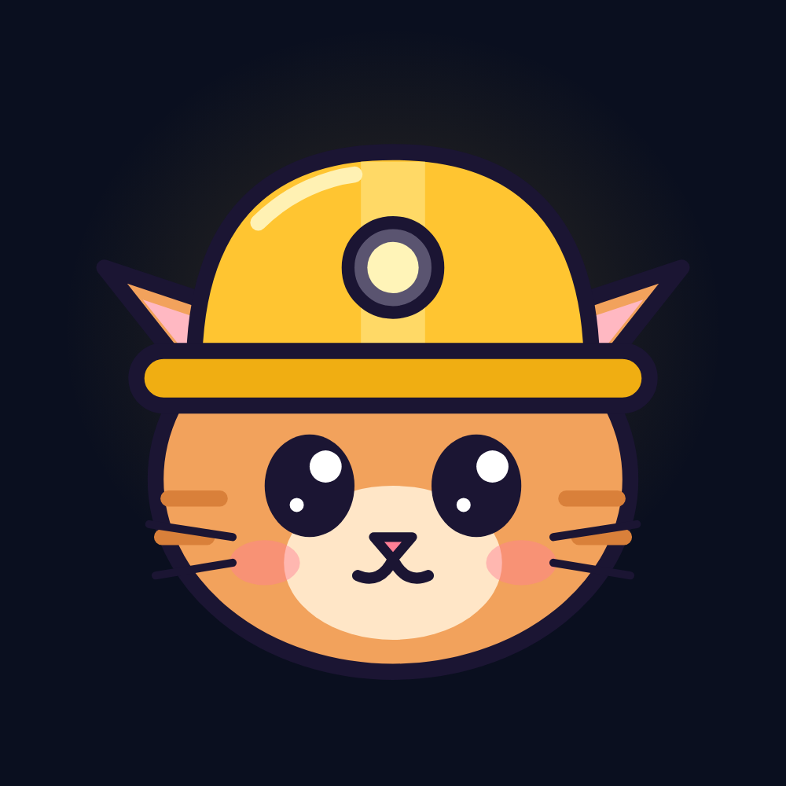

# trenchmates

**YOUR AI TRENCH AGENT. BUILT FROM YOUR X. PAID IN $PAWS.**

Sign in with X and a personal Solana agent is built from your feed in about a minute.
Paste a CA, get a verdict. Track any wallet. Give jobs to your assistant. Earn $PAWS for all of it.

[](https://trenchmates.xyz)
&nbsp;
[](https://x.com/trenchmates_sol)
&nbsp;
[](https://t.me/trenchmates_sol)


**$PAWS CA**

```
5Gm8HQAijLVzXSjbWRqzCEotJwKrrZS8BdKdsof6pump
```

[DexScreener](https://dexscreener.com/solana/5Gm8HQAijLVzXSjbWRqzCEotJwKrrZS8BdKdsof6pump) · [pump.fun](https://pump.fun/coin/5Gm8HQAijLVzXSjbWRqzCEotJwKrrZS8BdKdsof6pump) · [Solscan](https://solscan.io/token/5Gm8HQAijLVzXSjbWRqzCEotJwKrrZS8BdKdsof6pump)

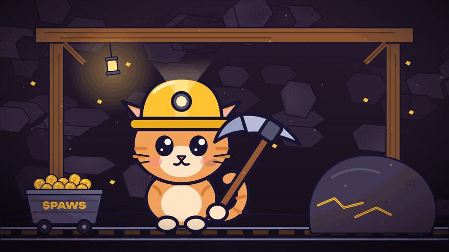

</div>

<br>

<div align="center">
</div>

<br>

## Paste a CA. Get a verdict.


One contract address in, one answer out. The agent pulls the facts in parallel, scores them with fixed rules, then explains them in plain words:

| | What it checks | Where it comes from |
|:-:|---|---|
| 1 | Mint and freeze authority, top 10 holders | Solana RPC (Helius) |
| 2 | Price, market cap, liquidity, volume, buys vs sells, pair age | DexScreener |
| 3 | Dev wallet history, launch-block bundle, snipers, dev buy | raw chain history (Helius) |
| 4 | Who is posting about it, and whether people **you follow** did | X (twitterapi.io) |
| 5 | **Verdict, 0-100 risk score, the agent's own take** | rules + LLM |

The score is never the model's opinion. The numbers come from the rules in [`src/lib/risk.ts`](src/lib/risk.ts); the LLM only puts them into words.

<br>

## The score is honest

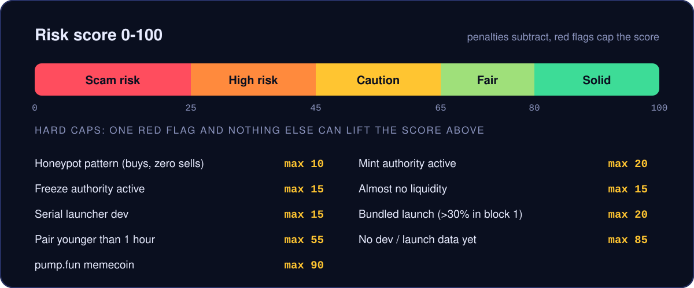

Every risky signal subtracts points. Obvious scam signals also **cap** the score, so great volume can never "offset" an active mint authority. A token without dev and launch data can't score above 85, and a pump.fun memecoin can't score above 90 however clean it looks. Details: [docs/RISK_SCORE.md](docs/RISK_SCORE.md).

<br>

## How the agent thinks

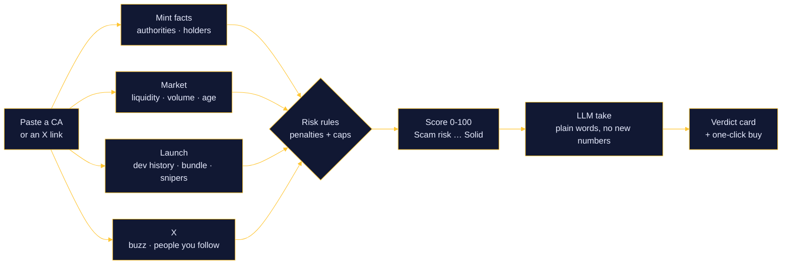

<br>

## Built from your X

<div align="center">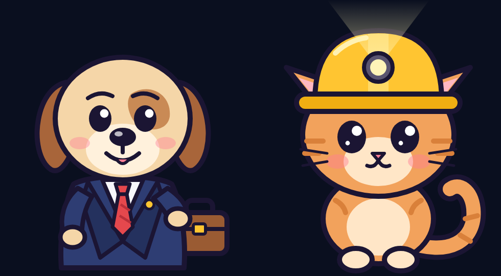</div>

Sign in with X (read-only) and the agent reads your profile, who you follow and your recent posts. It maps what you're into, picks a mascot, **a trencher cat or a dog in a suit**, and you give it a name. From then on it knows your circle: a scan tells you when accounts you follow posted the same CA.

The app never posts, likes or follows for you.

<br>

## Track any wallet

<table>
<tr>
<td width="58%"></td>
<td>

Paste any Solana wallet, give it a **name and an emoji**, and every buy and sell lands in your feed.

- **sold all** or **sold N%** on exits, so you know how much of the bag left
- **cluster alert** when two or more of your wallets buy the same token within 15 minutes
- top-center pop-ups, like the terminals you already use
- **⚡ quick buy** and **Scan CA** right on the alert
- minimum SOL filter per wallet, buys / sells toggles

</td>
</tr>
</table>

<br>

## Barkley takes the job


Barkley is your assistant. Give it jobs in plain words and it runs them on the server, even with the tab closed:

| You say | Barkley does |
|---|---|
| "send me the mcap of this CA in 5 minutes" | a one-off report at that time |
| "update me on this token every 10 minutes, 6 times" | a repeating report |
| "tell me when this CA's mcap goes above 1M" | an alert, checked every minute |
| "remind me at 18:00" | a reminder |
| "track wallet `<address>` as degen" | a wallet tracker |

Every result shows up in Activity, in Alerts and as a pop-up.

<br>

## Trade without leaving the scan

<table>
<tr>
<td width="50%">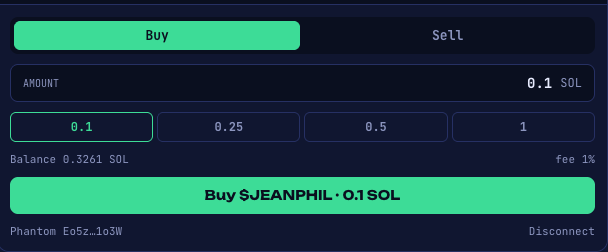<br><sub><b>Buy / sell.</b> Signed in your own wallet: Phantom, Solflare or Backpack.</sub></td>
<td width="50%">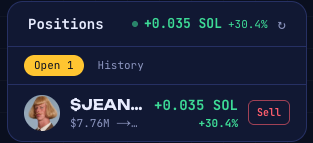<br><sub><b>Live PnL.</b> Market cap at your entry against market cap now.</sub></td>
</tr>
</table>

Swaps route through **Jupiter**. Non-custodial: keys and funds never touch the server. Trades made on trenchmates carry a **1% platform fee**, shown in the panel before you sign.

<br>

## $PAWS rewards

<table>
<tr>
<td width="44%"></td>
<td>

Everything you do on the site earns **$PAWS points**.

| Task | $PAWS |
|---|--:|
| Daily check-in (+50 per streak day) | 100 – 400 |
| Scan 3 tokens | 200 |
| Watch a token | 100 |
| Trade 0.1 / 0.5 / 1 SOL on the site | 1,000 / 7,000 / 15,000 |
| Follow @trenchmates_sol on X | 1,000 |
| Join the Telegram channel | 1,000 |
| Invite a friend (they get +500) | 2,000 |

Daily tasks and trade tiers reset at 00:00 UTC. Social tasks pay once.

</td>
</tr>
</table>

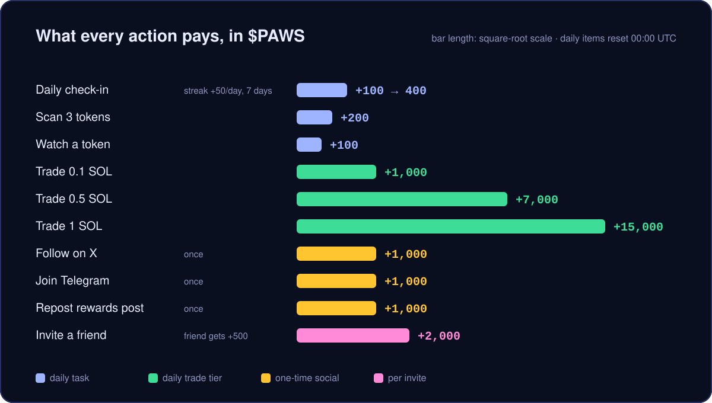

Rewards are decided on the server and every payout has a unique key per user, so nothing can be claimed twice (double clicks, retries, two tabs). X tasks are verified before they pay. Invite links use your X username: `trenchmates.xyz/?ref=<you>`. Details: [docs/REWARDS.md](docs/REWARDS.md).

<br>

## The agent answers on X too

```text
$FROG · 9/100 · Scam risk

- Almost no liquidity ($3K)
- Serial launcher: 12 of the dev's 12 recent tokens are dead
- Top 10 accounts hold 96% of supply

full scan on trenchmates.xyz
```

Drop a CA under one of our posts and the project account replies with the scan, usually within a minute. Same rules, same score. The reply bot only answers people who wrote to us first, once per reply, with hourly caps. Details: [docs/REPLY_BOT.md](docs/REPLY_BOT.md).

<br>

## Screens

<table>
<tr>
<td width="50%">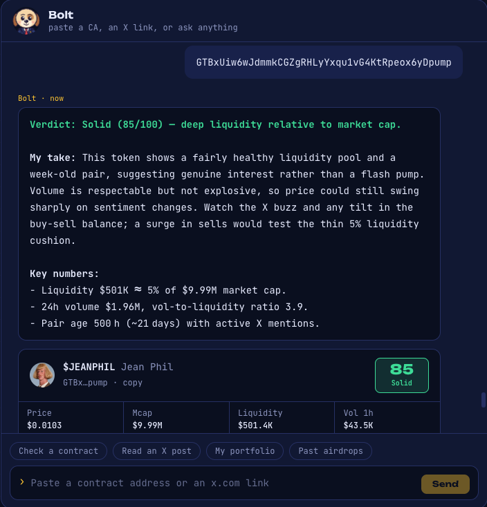<br><sub><b>Verdict.</b> The take, the key numbers, the score.</sub></td>
<td width="50%">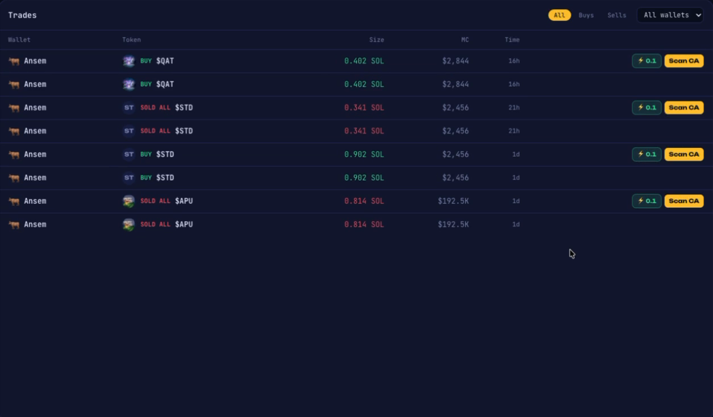<br><sub><b>Wallet trades.</b> Buys, exits, quick buy, scan.</sub></td>
</tr>
<tr>
<td>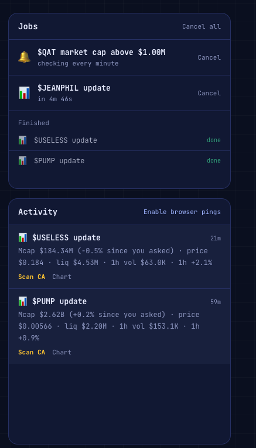<br><sub><b>Jobs.</b> What Barkley is doing and what it delivered.</sub></td>
<td>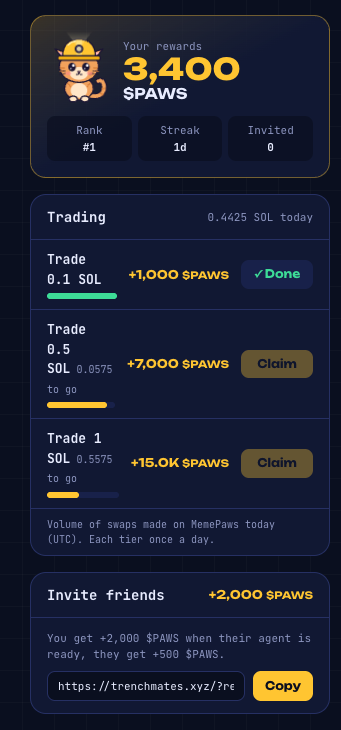<br><sub><b>Rewards.</b> Balance, streak, tiers, invite link.</sub></td>
</tr>
</table>

<br>

## Architecture

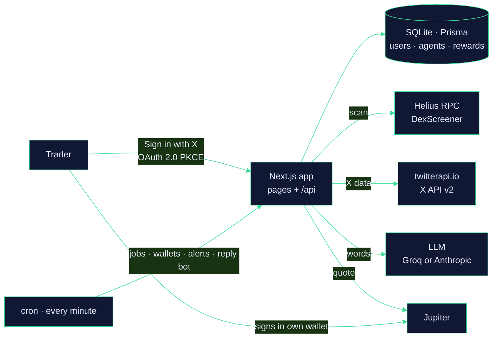

| Layer | Stack |
|---|---|
| App | Next.js 15 (App Router), React 19, Tailwind CSS 4, TypeScript |
| Data | Prisma 6 + SQLite (Postgres works with a one-line change) |
| Solana | `@solana/web3.js`, Helius RPC, DexScreener, Jupiter swaps |
| X | official API v2 for sign-in and posting, twitterapi.io for cheap reads |
| AI | any OpenAI-compatible API (Groq by default) or Anthropic |
| Jobs | one cron call per minute: Barkley jobs, wallet trackers, token and account watch, reply bot |

More: [docs/ARCHITECTURE.md](docs/ARCHITECTURE.md).

<br>

## Run it

```bash
git clone <this repo> trenchmates
cd trenchmates
cp .env.example .env     # fill in the keys, see SETUP.md
npm install              # also generates the Prisma client
npx prisma db push       # creates the SQLite database
npm run dev              # http://localhost:3000
```

Background jobs run from one endpoint, called every minute:

```bash
curl -H "Authorization: Bearer $CRON_SECRET" "http://localhost:3000/api/cron/tick?jobs=assistant,wallets"
```

Self-hosting on a VPS (systemd, Caddy, cron), every environment variable and the X app setup: **[SETUP.md](SETUP.md)**.

<details>
<summary><b>Project structure</b></summary>

```
src/
├── app/
│   ├── (app)/          dashboard (MemePaws), assistant (Barkley), wallets, watchlist,
│   │                   alerts, rewards (+ admin, reply bot), portfolio, airdrops, settings
│   ├── about/          public page: news, features, $PAWS, trust notes
│   ├── generate/       agent build screen: name your agent
│   └── api/            auth (X OAuth), agent, chat, analyze, token, swap, pnl,
│                       wallets, assistant, alerts, rewards, bot, cron/tick
├── components/         chat, token card, trade panel, positions, toasts, mascots
├── content/            about page content (news, features, $PAWS)
└── lib/
    ├── analyze.ts      token report: mint facts + market data
    ├── risk.ts         the 0-100 score: penalties and caps
    ├── devcheck.ts     dev history, launch bundle, snipers
    ├── agent.ts        agent build from X + chat with tools
    ├── assistant.ts    Barkley: reports, alerts, reminders
    ├── wallettrack.ts  wallet trackers, sold %, cluster alerts
    ├── rewards.ts      $PAWS: tasks, tiers, streaks, invites
    ├── replybot.ts     answers CAs under project posts on X
    ├── jupiter.ts      swaps (quote, execute, platform fee)
    ├── x.ts, xdata.ts  X API v2 and twitterapi.io
    └── llm.ts          OpenAI-compatible or Anthropic
prisma/                 schema (SQLite)
public/                 icon, OG image
docs/                   architecture, risk score, rewards, reply bot
```

</details>

<details>
<summary><b>Docs</b></summary>

- [Architecture](docs/ARCHITECTURE.md)
- [Risk score](docs/RISK_SCORE.md)
- [$PAWS rewards](docs/REWARDS.md)
- [Reply bot](docs/REPLY_BOT.md)
- [Self-hosting](SETUP.md)

</details>

<br>

## Trust

- **Non-custodial.** We never hold your keys or funds. Every trade is signed in your own wallet.
- **X access is read-only.** The app never posts, likes or follows for you.
- **One official CA.** `5Gm8HQAijLVzXSjbWRqzCEotJwKrrZS8BdKdsof6pump` is the only $PAWS contract address. It is posted on trenchmates.xyz, [@trenchmates_sol](https://x.com/trenchmates_sol) and our Telegram. Ignore any other CA.
- **AI verdicts can be wrong.** Nothing here is financial advice. Do your own research.

<br>

<div align="center">
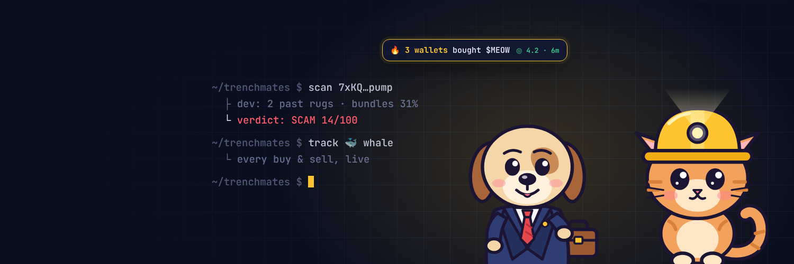

<br>

**YOUR AI TRENCH AGENT. BUILT FROM YOUR X. PAID IN $PAWS.**

<sub><a href="https://trenchmates.xyz">trenchmates.xyz</a> · <a href="https://x.com/trenchmates_sol">@trenchmates_sol</a> · <a href="https://t.me/trenchmates_sol">Telegram</a></sub>
</div>
