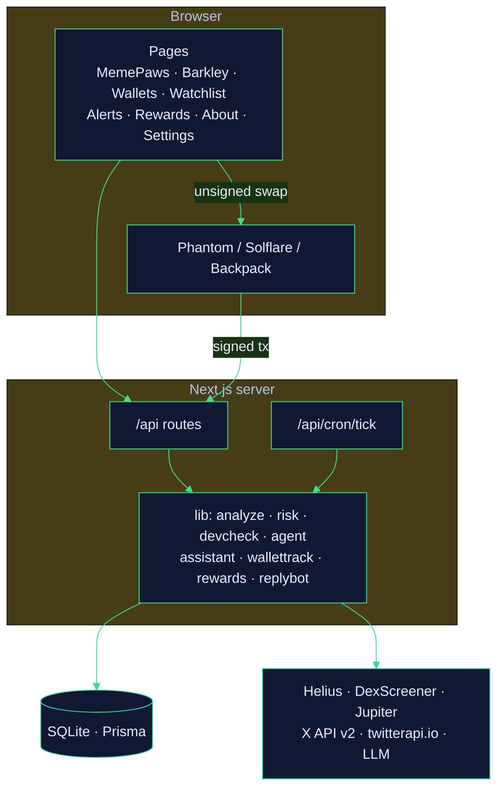

# Architecture

One Next.js app serves the pages and the API. A SQLite database (Prisma) holds users, agents and everything they set up. Background work runs from a single endpoint that a cron hits every minute.

## Sign-in and agent build

1. `/api/auth/x/login` starts X OAuth 2.0 with PKCE (scopes: `tweet.read users.read follows.read offline.access`).
2. `/api/auth/x/callback` stores the user, encrypted tokens and an invite referrer if the visitor came with `?ref=`.
3. `/generate` → `/api/agent/generate` reads the profile, who the user follows and recent posts, builds an interest profile and an agent (mascot, character). The user names the agent.

## Scan

`analyzeToken` (mint facts from Helius, market data from DexScreener) and `devCheck` (deployer history, launch bundle, snipers from raw chain history) run in parallel with an X mentions lookup. `computeRisk` turns the facts into the 0-100 score, see [RISK_SCORE.md](RISK_SCORE.md). The chat model gets the facts and writes the take; it can't change the numbers.

## Trading

`/api/swap/order` asks Jupiter for an unsigned transaction with the platform fee. The wallet extension signs it in the browser, `/api/swap/execute` sends it through Jupiter and records a `SiteTrade` (used for Positions and trading tiers). Keys never reach the server.

## Background jobs

`/api/cron/tick?jobs=…` (Bearer `CRON_SECRET`):

| Job | What it does | Suggested cadence |
|---|---|---|
| `assistant` | Barkley reports, alerts and reminders; also runs the reply bot | every minute |
| `wallets` | new trades of tracked wallets, sold %, cluster alerts | every minute |
| `tokens` | volume spikes and sharp moves on watchlist tokens | every 5 minutes |
| `discovery` | new token profiles worth a look | every 5 minutes |
| `accounts` | new posts from watched project accounts | every 15 minutes |
| `digest` | morning digest | hourly |

## Data model

| Model | Holds |
|---|---|
| `User` | X profile, encrypted tokens, referral, Telegram chat |
| `Agent` | the built agent: name, mascot, interests |
| `Wallet` | the user's own wallets (positions, PnL) |
| `WatchItem`, `SeenToken`, `Alert` | watchlist and alerts |
| `Message` | chat history with the agent |
| `AssistantTask`, `AssistantMessage` | Barkley's jobs and chat |
| `TrackedWallet` | wallet tracker settings |
| `SiteTrade` | swaps made on the site |
| `RewardTask`, `RewardEvent` | reward tasks and every payout |
| `BotAccount`, `ReplyCampaign`, `BotReply` | the reply bot |

## Costs worth knowing

- X data goes through twitterapi.io where possible (about 100x cheaper than the official API). Sign-in and the reply bot's posts use the official API.
- `X_MAX_FOLLOWING` and `X_MAX_POSTS` cap how much is read per new user.
- `CHAT_DAILY_LIMIT` caps chat messages per user per day. When the model is rate-limited, scans still work without it.
