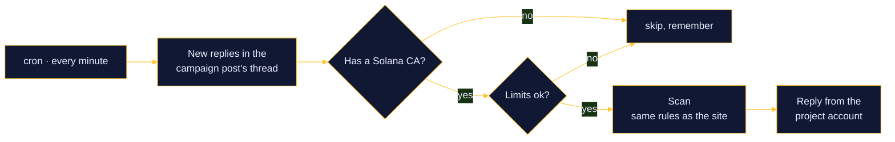

# Reply bot

Drop a CA under one of the project's posts on X and the project account answers with the scan. Code: [`src/lib/replybot.ts`](../src/lib/replybot.ts), admin API [`src/app/api/bot/route.ts`](../src/app/api/bot/route.ts), page `/rewards/admin/bot`.

## Flow



A reply looks like this:

```text
$FROG · 9/100 · Scam risk

- Almost no liquidity ($3K)
- Serial launcher: 12 of the dev's 12 recent tokens are dead
- Top 10 accounts hold 96% of supply

full scan on trenchmates.xyz
```

Up to three reasons: the worst ones for risky tokens, the best two plus the worst one for clean tokens. Scans are cached for 10 minutes per mint.

## Limits

So the account never looks like spam:

- only replies in the threads of posts you turned the bot on for (people who wrote to you first)
- every source reply is looked at once (`BotReply.sourceTweetId` is unique)
- at most 3 answers per person per post
- a per-post hourly cap (30 by default, 1 to 120)
- at most 4 posts per cron run
- a reply row is written before posting, so a crash can never double-post
- on 401 / 402 / 403 / 429 from X the run stops instead of failing every reply

## Setup

1. In the X developer portal, set the app's permissions to **Read and write**.
2. In the browser, switch X to the project account. Stay signed in to the site as an admin.
3. Open `/rewards/admin/bot` → **Connect project X account**. Tokens are stored encrypted (AES-GCM) and refreshed automatically.
4. Paste a CA into **Preview a reply** to see the exact text without posting.
5. Paste the post link into **Turn the bot on for a post**. Optionally add "reply" and "quote" reward tasks for the same post.

The page shows replied / skipped / failed counts, links to each answer, the last error, and Pause / Resume / Delete per post. **Run now** does one pass immediately.

## Cost

Reading replies goes through twitterapi.io (fractions of a cent per page). Each answer is one post on the official X API, billed per post on pay-per-use plans.
